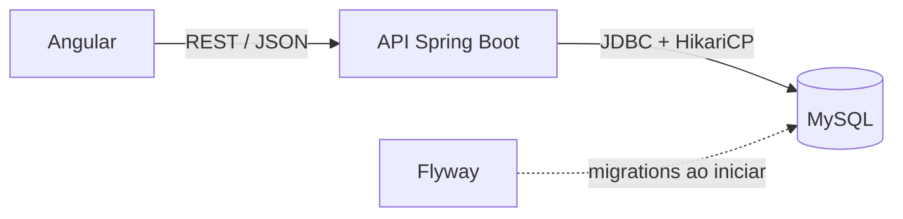

# Gerenciador de Tarefas

Aplicação web de gerenciamento de tarefas em formato Kanban, com **histórico completo de alterações** e **cronômetro de esforço**. Cada pessoa tem o seu próprio quadro.

É um projeto de portfólio construído do zero até o deploy, com foco em código simples de ler, SQL explícito (sem ORM) e decisões técnicas documentadas.

> **Status:** em desenvolvimento. Meta do MVP: 15/12/2026.
> **Demo:** _em breve_ · **Capturas de tela:** _em breve_

## Funcionalidades do MVP

- [ ] Cadastro, login e logout com e-mail e senha (JWT com refresh token)
- [ ] Quadro Kanban com as colunas **A fazer**, **Em andamento** e **Concluído**, com arrastar e soltar
- [ ] Tarefas com título, descrição, prioridade, prazo opcional e esforço estimado
- [ ] **Histórico por campo** de toda alteração (quem mudou, o quê, de qual valor para qual, quando)
- [ ] Cronômetro iniciar/pausar que gera lançamentos de tempo, com anotação opcional, e esforço real calculado
- [ ] Etiquetas coloridas e filtro do quadro por etiqueta
- [ ] Isolamento total entre usuários: cada um vê apenas as próprias tarefas
- [ ] Tarefas nunca são apagadas: ficam inativas e preservam histórico e tempo lançado

## Stack

| Camada | Tecnologia |
| --- | --- |
| Backend | Java 27, Spring Boot, JDBC puro (`java.sql`) com HikariCP |
| Banco de dados | MySQL 8, migrations com Flyway |
| Autenticação | Spring Security, JWT (access token) e refresh token com rotação |
| Frontend | Angular (versão mais recente), Angular Material e CDK |
| Infra | Docker, GitHub Actions (build), deploy em serviços gratuitos |

## Arquitetura



### Decisões técnicas

- **JDBC puro em vez de JPA.** Todo SQL é escrito à mão com `PreparedStatement` e mapeado manualmente para `records`. Dá controle total sobre as consultas e deixa explícito o que roda no banco.
- **Transação controlada pelo service.** O service abre a `Connection`, desliga o auto-commit, passa a mesma conexão ao DAO e ao registro de histórico, e faz commit ou rollback. Assim a alteração da tarefa e o seu histórico nunca ficam dessincronizados.
- **Histórico por campo.** Uma linha por campo alterado (campo, valor antigo, valor novo, usuário e momento), gravada pela aplicação. Só grava quando o valor realmente mudou.
- **Sem exclusão física.** Tarefas viram inativas. O histórico e os lançamentos de tempo são preservados.
- **Esforço real derivado.** Não é guardado na tarefa; é a soma dos lançamentos de tempo, que são a fonte da verdade.
- **Cronômetro no servidor.** O horário de início é gravado no servidor, então a contagem sobrevive a recarregar a página, e o banco impede dois cronômetros abertos para o mesmo usuário.
- **Colunas modeladas em tabela.** São fixas no MVP, mas já ficam em uma tabela de status para permitir colunas personalizadas depois.
- **Migrations versionadas.** O schema nasce e evolui só por scripts do Flyway, o mesmo em desenvolvimento e produção.

## Como rodar localmente

### Pré-requisitos

- JDK 27
- Node.js (versão LTS atual) e npm
- Docker e Docker Compose

### Passo a passo

```bash
# 1. Banco de dados (MySQL em container)
docker compose up -d

# 2. Backend (aplica as migrations do Flyway ao iniciar)
cd backend
SPRING_PROFILES_ACTIVE=dev ./mvnw spring-boot:run

# 3. Frontend (em outro terminal)
cd frontend
npm install
npm start
```

- Aplicação: http://localhost:4200
- API: http://localhost:8080/api/v1
- Verificação rápida da API: `curl http://localhost:8080/api/v1/saude`

Abra a aplicação e crie uma conta pela tela de cadastro.

## Configuração

O backend lê a configuração de variáveis de ambiente. O perfil `dev` já aponta para o MySQL do Docker Compose.

| Variável | Descrição |
| --- | --- |
| `SPRING_PROFILES_ACTIVE` | `dev` ou `prod` |
| `DB_URL` | URL JDBC do MySQL |
| `DB_USER` | Usuário do banco (precisa de permissão de DDL para o Flyway) |
| `DB_PASSWORD` | Senha do banco |
| `JWT_SECRET` | Segredo de assinatura do JWT (mínimo de 256 bits) |
| `CORS_ORIGIN` | Origem do frontend aceita pela API |
| `PORT` | Porta HTTP, quando fornecida pela plataforma de deploy |

Nunca versione segredos. Arquivos `.env` estão no `.gitignore`.

## Estrutura do repositório

```text
.
├── backend/                         # API Spring Boot
│   ├── src/main/java/               # config, web, servico, repositorio, dominio, historico, erro
│   ├── src/main/resources/db/migration/   # migrations do Flyway (V1, V2, ...)
│   └── Dockerfile
├── frontend/                        # Aplicação Angular
├── docker-compose.yml               # MySQL para desenvolvimento
└── .github/workflows/               # CI (build do backend e do frontend)
```

## Banco de dados

O schema é criado pelas migrations em `backend/src/main/resources/db/migration/`.

| Tabela | Finalidade |
| --- | --- |
| `usuarios` | Contas de usuário (senha somente como hash) |
| `refresh_tokens` | Refresh tokens, guardados como hash, com revogação |
| `status` | Colunas do Kanban |
| `tarefas` | Tarefas de cada usuário |
| `etiquetas` e `tarefa_etiquetas` | Etiquetas coloridas e sua ligação com as tarefas |
| `lancamentos_tempo` | Lançamentos do cronômetro |
| `historico_tarefas` | Histórico por campo de cada alteração |

## API

Prefixo `/api/v1`. Todas as rotas, exceto `saude` e as de `auth`, exigem `Authorization: Bearer <accessToken>`.

| Grupo | Rotas principais |
| --- | --- |
| Saúde | `GET /saude` |
| Autenticação | `POST /auth/cadastro`, `/auth/login`, `/auth/refresh`, `/auth/logout`, `GET /auth/eu` |
| Status | `GET /status` |
| Tarefas | `GET /tarefas/quadro`, `POST /tarefas`, `GET` e `PUT /tarefas/{id}`, `POST /tarefas/{id}/mover`, `/inativar`, `/reativar`, `GET /tarefas/{id}/historico` |
| Cronômetro | `POST /tarefas/{id}/cronometro/iniciar`, `POST /cronometro/pausar`, `GET /cronometro/atual`, `GET /tarefas/{id}/lancamentos` |
| Etiquetas | `GET`, `POST` e `PUT /etiquetas` |

Erros seguem sempre o mesmo formato, com `codigo`, `mensagem` e, em validações, `campos`.

## Deploy

- **Backend:** imagem Docker própria (Java 27) em um PaaS gratuito.
- **Frontend:** build estático em hosting gratuito.
- **Banco:** MySQL gratuito externo.

Como os serviços gratuitos hibernam quando ficam sem uso, **o primeiro acesso pode levar cerca de um minuto**.

## Roadmap pós-MVP

- Equipes e projetos (Equipe → Projeto → Tarefa), com administradores e edição restrita às próprias tarefas
- Colunas do Kanban personalizáveis
- Tokens de API com escopos, separados do token do portal
- Verificação de e-mail e recuperação de senha
- Testes automatizados de integração (Testcontainers)
- Deploy automático a cada push na `main`

## Contribuindo

Este é um projeto pessoal de portfólio. Sugestões e issues são bem-vindas. Para mudanças de código, abra uma issue antes para alinharmos o escopo.

## Licença

A definir.

## Autor

Lucas Schwartz de Souza